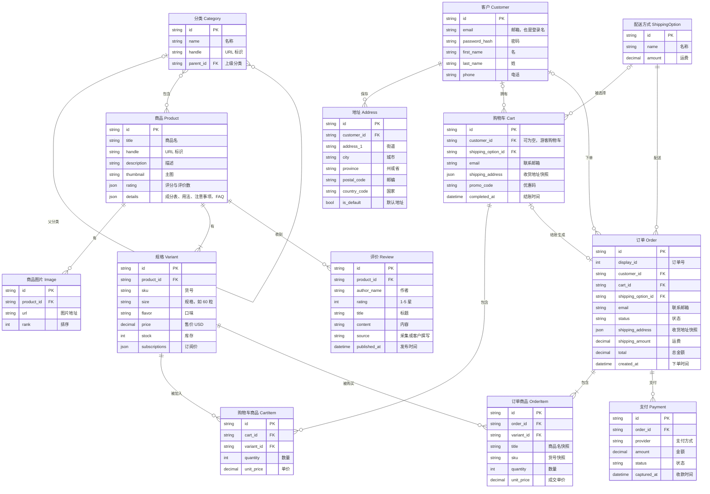

# FresshShop 简化版逻辑 ER 图

只画业务上真正存在的东西，一共 14 个实体。数据库里实际的 41 张表见 [er-diagram.md](./er-diagram.md)。

图片版：[er-diagram-simple.png](./er-diagram-simple.png)、[er-diagram-simple.svg](./er-diagram-simple.svg)

简化的方法：

- **合并模块连接表**：价格、库存在 Medusa 里是独立模块，这里直接作为“规格”的属性。
- **多对多直接画成 M:N**：比如商品和分类，中间表省略。
- **快照写成字段**：购物车、订单里复制的地址写成 `shipping_address` 字段，不单独成表。
- **去掉订单版本表**：`order_item / order_shipping / order_summary` 的版本信息不画。
- **去掉框架内部拆分**：登录身份、支付会话、多币种价格集合等。

## 和实际数据表的对应关系

| 逻辑实体 | 实际表 |
|---|---|
| 分类 | `product_category`，以及 `product_category_product`（多对多中间表） |
| 商品 | `product`，以及 `product_collection`；成分表等详情在 `product.metadata` 里 |
| 商品图片 | `image` |
| 规格 | `product_variant`；尺码和口味来自 `product_option`、`product_option_value`、`product_variant_option`、`product_product_option`、`product_product_option_value` |
| 规格的价格 | `product_variant_price_set` → `price_set` → `price` |
| 规格的库存 | `product_variant_inventory_item` → `inventory_item` → `inventory_level` |
| 评价 | `review`（我们自定义的模块） |
| 客户 | `customer`；登录信息在 `auth_identity`、`provider_identity` |
| 地址 | `customer_address` |
| 购物车 | `cart`、`cart_address` |
| 购物车商品 | `cart_line_item` |
| 配送方式 | `shipping_option`，以及 `cart_shipping_method`、`order_shipping_method`（选中时的快照） |
| 订单 | `order`、`order_address`、`order_cart`、`order_summary`、`order_shipping` |
| 订单商品 | `order_line_item`、`order_item` |
| 支付 | `payment_collection`、`payment_session`、`payment`，以及 `cart_payment_collection`、`order_payment_collection` |

几点说明：

- 简化图里的 `password_hash`、`promo_code`、`total` 是逻辑上的字段。实际上它们在其他表里，或者是计算出来的：
  - 密码存在 `provider_identity.provider_metadata`。
  - 优惠码通过 `promotion` 关联，目前还没有使用数据。
  - 订单总额存在 `order_summary.totals`。
- 实际数据库里，支付挂在购物车上，通过 `payment_collection` 关联，下单时再关联到订单。简化图直接画成“订单 → 支付”。
