# FresshShop 实际使用的数据表 ER 图

Medusa 2.22 默认建了 149 张表。这里只画店铺功能真正用到的 41 张：商品目录、价格、库存、评价、
客户与登录、购物车、支付、订单。

挑表的依据：

1. 本地起库（`pnpm setup:local`）后导入 229 个 Metagenics 商品和评价；
2. 通过 Store API 走一遍前端用到的完整流程：注册、加地址、建购物车、加商品、选配送、
   支付会话、下单、写评价；
3. 统计每张表的行数，再对照前端调用的 `/store/*` 接口，留下有数据且属于业务的表。

没画出来的：迁移记录、API key、搜索索引、工作流、后台用户、税、配送区域/履约内部表、币种列表、
促销（前端支持输入优惠码，但目前没有用过的数据）、退货/换货/索赔等（前端没有用到）。

图例：**实线** = 数据库里真的有外键；**虚线** = 只存了 ID（Medusa 跨模块用 link 表或字段关联，
没有数据库外键）。每张表只列主要字段，`created_at / updated_at / deleted_at` 和 `raw_*` 省略。

```mermaid
erDiagram
    %% ========== 商品目录 ==========
    product_collection ||--o{ product : "collection_id"
    product ||--o{ product_variant : "product_id"
    product ||--o{ image : "product_id"
    product ||--o{ product_category_product : ""
    product_category ||--o{ product_category_product : ""
    product_category |o--o{ product_category : "parent_category_id"
    product ||--o{ product_product_option : ""
    product_option ||--o{ product_product_option : ""
    product_option ||--o{ product_option_value : "option_id"
    product_product_option ||--o{ product_product_option_value : ""
    product_option_value ||--o{ product_product_option_value : ""
    product_variant ||--o{ product_variant_option : ""
    product_option_value ||--o{ product_variant_option : ""
    product ||..o{ review : "product_id"

    %% ========== 价格 ==========
    product_variant ||..|| product_variant_price_set : "link"
    price_set ||..|| product_variant_price_set : "link"
    price_set ||--o{ price : "price_set_id"

    %% ========== 库存 ==========
    product_variant ||..|| product_variant_inventory_item : "link"
    inventory_item ||..|| product_variant_inventory_item : "link"
    inventory_item ||--o{ inventory_level : "inventory_item_id"

    %% ========== 客户与登录 ==========
    auth_identity ||--o{ provider_identity : "auth_identity_id"
    auth_identity |o..o| customer : "app_metadata.customer_id"
    customer ||--o{ customer_address : "customer_id"

    %% ========== 购物车 ==========
    region ||..o{ cart : "region_id"
    customer |o..o{ cart : "customer_id"
    cart ||--o{ cart_line_item : "cart_id"
    cart }o--o| cart_address : "shipping/billing_address_id"
    cart ||--o{ cart_shipping_method : "cart_id"
    shipping_option ||..o{ cart_shipping_method : "shipping_option_id"
    product_variant ||..o{ cart_line_item : "variant_id"

    %% ========== 支付 ==========
    cart ||..o| cart_payment_collection : "link"
    payment_collection ||..|| cart_payment_collection : "link"
    payment_collection ||--o{ payment_session : "payment_collection_id"
    payment_collection ||--o{ payment : "payment_collection_id"

    %% ========== 订单 ==========
    cart ||..o| order_cart : "link"
    order ||..|| order_cart : "link"
    order ||..o{ order_payment_collection : "link"
    payment_collection ||..|| order_payment_collection : "link"
    customer |o..o{ order : "customer_id"
    region ||..o{ order : "region_id"
    order }o--o| order_address : "shipping/billing_address_id"
    order ||--o{ order_item : "order_id"
    order_line_item ||--o{ order_item : "item_id"
    order ||--o{ order_shipping : "order_id"
    order_shipping_method ||..o{ order_shipping : "shipping_method_id"
    order ||--o{ order_summary : "order_id"
    product_variant ||..o{ order_line_item : "variant_id"

    product {
        text id PK
        text title
        text handle
        text subtitle
        text description
        text status
        text thumbnail
        text collection_id FK
        jsonb metadata "rating, form, supplement_facts, faq…"
    }
    product_variant {
        text id PK
        text product_id FK
        text title
        text sku
        bool manage_inventory
        int variant_rank
        text thumbnail
        jsonb metadata "size, flavor, subscriptions"
    }
    product_option {
        text id PK
        text title "Size / Flavor"
    }
    product_option_value {
        text id PK
        text option_id FK
        text value
        int rank
    }
    product_product_option {
        text id PK
        text product_id FK
        text product_option_id FK
    }
    product_product_option_value {
        text id PK
        text product_product_option_id FK
        text product_option_value_id FK
    }
    product_variant_option {
        text variant_id FK
        text option_value_id FK
    }
    image {
        text id PK
        text product_id FK
        text url
        int rank
    }
    product_category {
        text id PK
        text name
        text handle
        text parent_category_id FK
        int rank
        bool is_active
    }
    product_category_product {
        text product_id FK
        text product_category_id FK
    }
    product_collection {
        text id PK
        text title
        text handle
    }
    review {
        text id PK
        text product_id "逻辑关联 product"
        text author_name
        text location
        int rating "1-5"
        text title
        text content
        text source "collected / customer"
        text status
        timestamptz published_at
    }
    product_variant_price_set {
        varchar id PK
        varchar variant_id
        varchar price_set_id
    }
    price_set {
        text id PK
    }
    price {
        text id PK
        text price_set_id FK
        text currency_code
        numeric amount
        numeric min_quantity
        numeric max_quantity
    }
    product_variant_inventory_item {
        varchar id PK
        varchar variant_id
        varchar inventory_item_id
        numeric required_quantity
    }
    inventory_item {
        text id PK
        text sku
        text title
        bool requires_shipping
    }
    inventory_level {
        text id PK
        text inventory_item_id FK
        text location_id
        numeric stocked_quantity
        numeric reserved_quantity
    }
    region {
        text id PK
        text name
        text currency_code
    }
    auth_identity {
        text id PK
        jsonb app_metadata "customer_id"
    }
    provider_identity {
        text id PK
        text auth_identity_id FK
        text provider "emailpass"
        text entity_id "邮箱"
    }
    customer {
        text id PK
        text email
        text first_name
        text last_name
        text phone
        bool has_account
    }
    customer_address {
        text id PK
        text customer_id FK
        text address_name
        bool is_default_shipping
        bool is_default_billing
        text address_1
        text city
        text province
        text postal_code
        text country_code
        text phone
    }
    cart {
        text id PK
        text region_id
        text customer_id
        text email
        text currency_code
        text shipping_address_id FK
        text billing_address_id FK
        timestamptz completed_at
    }
    cart_address {
        text id PK
        text first_name
        text last_name
        text address_1
        text city
        text postal_code
        text country_code
    }
    cart_line_item {
        text id PK
        text cart_id FK
        text variant_id
        text product_id
        text title
        int quantity
        numeric unit_price
        jsonb metadata
    }
    cart_shipping_method {
        text id PK
        text cart_id FK
        text shipping_option_id
        text name
        numeric amount
    }
    shipping_option {
        text id PK
        text name
        text price_type
    }
    cart_payment_collection {
        varchar id PK
        varchar cart_id
        varchar payment_collection_id
    }
    payment_collection {
        text id PK
        text currency_code
        numeric amount
        numeric authorized_amount
        numeric captured_amount
        text status
    }
    payment_session {
        text id PK
        text payment_collection_id FK
        text provider_id
        numeric amount
        text status
    }
    payment {
        text id PK
        text payment_collection_id FK
        text payment_session_id
        text provider_id
        numeric amount
        timestamptz captured_at
    }
    order_cart {
        varchar id PK
        varchar order_id
        varchar cart_id
    }
    order_payment_collection {
        varchar id PK
        varchar order_id
        varchar payment_collection_id
    }
    order {
        text id PK
        int display_id
        text region_id
        text customer_id
        text email
        text currency_code
        text status
        int version
        text shipping_address_id FK
        text billing_address_id FK
    }
    order_address {
        text id PK
        text first_name
        text last_name
        text address_1
        text city
        text postal_code
        text country_code
    }
    order_item {
        text id PK
        text order_id FK
        text item_id FK
        int version
        numeric quantity
        numeric fulfilled_quantity
        numeric unit_price
    }
    order_line_item {
        text id PK
        text variant_id
        text product_id
        text title
        text variant_sku
        numeric unit_price
    }
    order_shipping {
        text id PK
        text order_id FK
        text shipping_method_id
        int version
    }
    order_shipping_method {
        text id PK
        text shipping_option_id
        text name
        numeric amount
    }
    order_summary {
        text id PK
        text order_id FK
        int version
        jsonb totals
    }
```

## 几个容易看不懂的地方

- **商品选项**：2.22 里 `product_option` 可以被多个商品共用，商品和选项之间靠
  `product_product_option` / `product_product_option_value` 连起来；具体某个规格（variant）
  选了哪个值，记在 `product_variant_option`。
- **价格和库存不在商品表里**：variant 通过 link 表连到 `price_set → price`（每个币种一行）和
  `inventory_item → inventory_level`（每个仓库一行，存在库/已预留数量）。
- **订阅价、评分、成分表等都存在 `metadata`（jsonb）里**，不是单独的表，见 `backend/README.md`。
- **订单有版本**：`order_item`、`order_shipping`、`order_summary` 都带 `version`，订单每次修改
  会产生新版本；`order_line_item` 是下单时的商品快照（标题、SKU、单价），商品以后改了也不影响旧订单。
- **购物车和订单的地址是复制出来的**：`cart_address` / `order_address` 是快照，和客户地址簿
  `customer_address` 没有外键关系。
